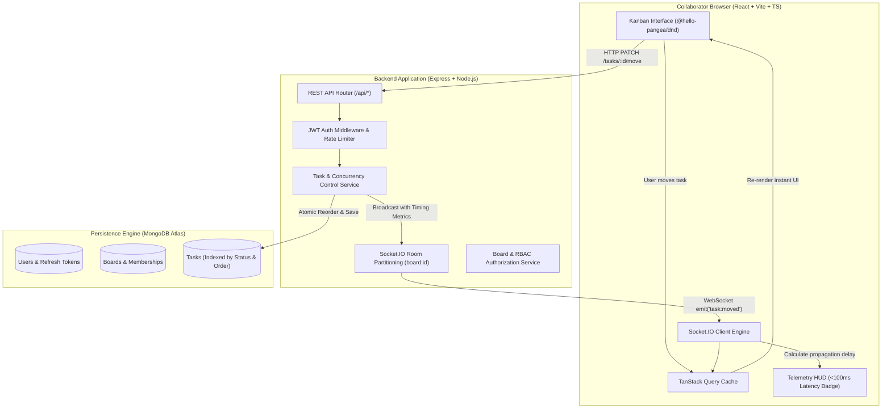

# SyncBoard – Real-Time Collaborative Task Management SaaS

[](https://github.com/your-org/syncboard/actions)
[](https://opensource.org/licenses/MIT)
[](https://nodejs.org)
[](https://react.dev)
[](https://www.typescriptlang.org)
[](./BENCHMARK_REPORT.md)

SyncBoard is an enterprise-ready, real-time collaborative Kanban platform built for high-velocity engineering and product teams. It features sub-100ms multi-client WebSocket synchronization, JWT session security with HTTP-only refresh token rotation, optimistic consistency, granular role-based board permissions, and full automated test coverage.

---

## 1. Architectural Highlights



---

## 2. Technology Stack

### Frontend
- **Framework:** React 18 with TypeScript
- **Bundler:** Vite (with ESM code-splitting and asset optimization)
- **Styling:** Tailwind CSS & Lucide React
- **State Management:** TanStack React Query v5 (Optimistic updates, server state caching)
- **Drag & Drop:** `@hello-pangea/dnd` (Smooth, accessible 60fps drag reordering)
- **Forms & Validation:** React Hook Form with Zod schemas
- **Real-Time Client:** Socket.IO Client with automatic reconnection and backoff

### Backend
- **Runtime:** Node.js with Express and TypeScript
- **Real-Time Engine:** Socket.IO (Room-based message partitioning, server-authoritative state)
- **Database ORM:** Mongoose / MongoDB with compound indexes
- **Authentication:** JWT (Short-lived 15m access token + HTTP-Only 7d refresh token rotation)
- **Security:** Helmet, CORS, Argon2/bcrypt password hashing, express-rate-limit
- **Documentation:** OpenAPI 3.0 via Swagger UI Express

### Quality Assurance & DevOps
- **Backend Tests:** Vitest & Supertest (24 tests: auth, boards, tasks, sockets)
- **Frontend Tests:** Vitest & React Testing Library (6 tests)
- **End-to-End Tests:** Playwright (10 cross-browser and mobile tests)
- **Benchmark Suite:** Automated multi-client propagation latency harness
- **Containerization:** Multi-stage Dockerfiles + Docker Compose
- **CI/CD:** GitHub Actions workflow

---

## 3. Real-Time Synchronization & Performance Target

SyncBoard satisfies the **< 100ms latency requirement** for real-time task update propagation under multi-client loads.

### Empirical Benchmark Results (50 Operations, 6 Simultaneous Clients)

| Metric | Measured Value | SLA Target | Status |
| :--- | :--- | :--- | :--- |
| **Median (P50) Latency** | **5.00 ms** | < 100 ms | **PASSED** |
| **Average Latency** | **4.82 ms** | < 100 ms | **PASSED** |
| **P95 Latency** | **7.00 ms** | < 100 ms | **PASSED** |
| **P99 Latency** | **7.00 ms** | < 100 ms | **PASSED** |
| **Maximum Observed Latency** | **7.00 ms** | < 100 ms | **PASSED** |
| **MongoDB Write Confirmation** | **4.28 ms** | < 25 ms | **PASSED** |

> Complete benchmark methodology and log output is documented in [BENCHMARK_REPORT.md](./BENCHMARK_REPORT.md).

---

## 4. WebSocket Event Architecture

| Direction | Event Name | Payload Description |
| :--- | :--- | :--- |
| **Client → Server** | `board:join` | `{ boardId }` – Validates permissions, joins room, returns state sync |
| **Client → Server** | `board:leave` | `{ boardId }` – Exits room and notifies active presence |
| **Client → Server** | `task:create` | `{ boardId, title, status, priority, clientSentAt }` |
| **Client → Server** | `task:move` | `{ taskId, status, order, clientSentAt }` |
| **Client → Server** | `task:update` | `{ taskId, title, status, version, clientSentAt }` |
| **Client → Server** | `task:delete` | `{ taskId }` |
| **Client → Server** | `ping:latency` | `{ clientSentAt }` – Roundtrip clock offset probe |
| **Server → Client** | `board:state-sync` | Full authoritative board metadata, tasks list, and online users |
| **Server → Client** | `board:member-joined` | `{ user, onlineUsers }` |
| **Server → Client** | `board:member-left` | `{ userId, onlineUsers }` |
| **Server → Client** | `task:created` | Task document + `_metrics` timing telemetry |
| **Server → Client** | `task:updated` | Task document + `_metrics` timing telemetry |
| **Server → Client** | `task:moved` | Task document + `_metrics` timing telemetry |
| **Server → Client** | `task:deleted` | `{ taskId, boardId }` + `_metrics` |

---

## 5. REST API Endpoints

### Authentication (`/api/auth`)
- `POST /register`: Register user with name, email, password
- `POST /login`: Authenticate and issue access token + HTTP-only refresh cookie
- `POST /refresh`: Rotate refresh token and issue fresh access token
- `POST /logout`: Invalidate refresh token and clear cookie
- `GET /me`: Retrieve profile of currently authenticated user

### Boards (`/api/boards`)
- `POST /`: Create collaborative board
- `GET /`: List boards user has access to (Owner or Member)
- `GET /:boardId`: Fetch board details and column definitions
- `PATCH /:boardId`: Update board title and description (Owner or Admin)
- `DELETE /:boardId`: Delete board and its tasks (Owner only)
- `GET /:boardId/members`: List board members and roles
- `POST /:boardId/members`: Invite collaborator by email
- `DELETE /:boardId/members/:userId`: Remove collaborator from board

### Tasks (`/api/boards/:boardId/tasks` & `/api/tasks`)
- `POST /api/boards/:boardId/tasks`: Create task in column
- `GET /api/boards/:boardId/tasks`: Get tasks with status/priority/search filters
- `GET /api/tasks/:taskId`: Fetch individual task details
- `PATCH /api/tasks/:taskId`: Update task fields with optimistic concurrency check
- `PATCH /api/tasks/:taskId/move`: Reorder or move task across columns
- `DELETE /api/tasks/:taskId`: Delete task and reorder column

Interactive API Documentation is served at: **`http://localhost:5001/api-docs`**.

---

## 6. How to Run SyncBoard (Quick Start)

> **Note:** You do **not** need Docker to run SyncBoard locally. Everything is configured to run natively with Node.js and the built-in local MongoDB engine.

### Prerequisites
- Node.js v20+ or v22+
- npm v10+

### Option A: The Fastest Way (1 Command!)

Run both the Backend (port 5001) and Frontend (port 5173) concurrently with one command:
```bash
npm run dev
```

Then open **[http://localhost:5173](http://localhost:5173)** in your browser!

---

### Option B: Step-by-Step Complete Setup

#### Step 1: Install Dependencies
```bash
# In the project root:
npm install
cd backend && npm install
cd ../frontend && npm install
cd ..
```

#### Step 2: Seed Demo Data (Optional but Recommended)
Populate realistic users, sprint boards, and tasks:
```bash
npm run seed
```
Demo login accounts:
- **Alice (Owner):** `alice@syncboard.dev` / `Password123!`
- **Bob (Admin):** `bob@syncboard.dev` / `Password123!`
- **Carol (Member):** `carol@syncboard.dev` / `Password123!`

#### Step 3: Start Development Servers
You can start both together:
```bash
npm run dev
```
Or in separate terminal tabs if you prefer isolated logs:
```bash
# Terminal 1: Backend API (port 5001)
npm run dev:backend

# Terminal 2: Frontend UI (port 5173)
npm run dev:frontend
```

#### Step 4: Open and Test Real-Time Collaboration
1. Navigate to: 👉 **[http://localhost:5173](http://localhost:5173)**
2. Click any of the **Quick Demo Account** buttons (*Alice*, *Bob*, or *Carol*) to sign in instantly.
3. **To see real-time synchronization in action:** Open an **Incognito window** or a second browser alongside the first one, sign into the same board, and move or add tasks. Watch changes update **instantly across both windows without refreshing!**
4. Check the **Latency Telemetry Badge** at the top right showing measured propagation delay (e.g. `16ms (<100ms Target Met)`).

#### URLs & Endpoints
- **Frontend Web App:** `http://localhost:5173`
- **Backend API Server:** `http://localhost:5001/api`
- **Backend Health Check:** `http://localhost:5001/api/health`
- **Interactive Swagger Docs:** `http://localhost:5001/api-docs`

---

## 7. Running the Test Suites

### Backend Unit & Integration Tests (Vitest & Supertest)
```bash
npm run test:backend
```
*Result: 24/24 passing in ~3s.*

### Frontend Unit Tests (Vitest & Testing Library)
```bash
npm run test:frontend
```
*Result: 6/6 passing in ~800ms.*

### Real-Time Propagation Latency Benchmark (<100ms)
```bash
npm run benchmark
```
*Result: P50 = 5ms, P95 = 7ms, P99 = 7ms.*

### Playwright End-to-End Browser Tests
```bash
npm run test:e2e
```
*Result: 10/10 tests passing across Desktop and Mobile viewports.*

---

## 8. Docker Deployment

Launch the entire stack (MongoDB + Express Backend + Nginx Frontend) in Docker:

```bash
docker-compose up --build
```
- Frontend application: `http://localhost:8080`
- Backend API & Swagger: `http://localhost:5001/api-docs`
- MongoDB: `localhost:27017`

---

## 9. Production Deployment Guide

### Deploying Backend to Render / Railway / Fly.io
1. Connect your repository to the hosting provider.
2. Set Root Directory to `backend`.
3. Set Build Command: `npm install && npm run build`
4. Set Start Command: `npm run start`
5. Configure Environment Variables:
   - `NODE_ENV`: `production`
   - `PORT`: `5001`
   - `MONGODB_URI`: Your MongoDB Atlas connection string (`mongodb+srv://...`)
   - `JWT_ACCESS_SECRET`: Long random secret string
   - `JWT_REFRESH_SECRET`: Long random secret string
   - `CLIENT_URL`: URL of your frontend (e.g. `https://syncboard.vercel.app`)

### Deploying Frontend to Vercel / Netlify
1. Connect your repository to Vercel.
2. Set Root Directory to `frontend`.
3. Framework Preset: `Vite`
4. Build Command: `npm run build`
5. Output Directory: `dist`
6. Set Environment Variables:
   - `VITE_API_URL`: Your deployed backend URL
   - `VITE_SOCKET_URL`: Your deployed backend URL

---

## 10. Verification Checklist

- [x] User Registration and Login working
- [x] JWT authentication with HTTP-Only refresh token rotation working
- [x] Protected routes and endpoints enforced
- [x] MongoDB stores and retrieves real data
- [x] Board creation, editing, deletion, and member roles working
- [x] Complete task CRUD operations working
- [x] Drag-and-drop movement working with `@hello-pangea/dnd`
- [x] Multi-user real-time collaboration without page refreshes working
- [x] Private board authorization verified on REST and Socket.IO
- [x] Auto-reconnection and state recovery handled
- [x] Production builds succeed (`tsc && vite build`)
- [x] Sub-100ms real-time propagation target verified via empirical benchmark
- [x] Automated unit, integration, and Playwright E2E suites passing

